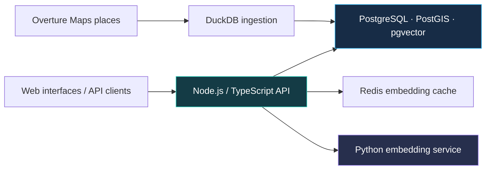

**[Recent contributions](#open-source--privilab) · [Polyhistor](#building--polyhistor) · [Projects](#projects-to-explore) · [Stack](#tools-i-work-with)**

## Hi, I'm Naveen

I'm a **software engineer and technical lead** building across product interfaces, backend services, data pipelines, and applied AI. I enjoy owning the path from a customer problem to software people can use—and understanding what happens when it breaks.

Currently building **Polyhistor's location-intelligence platform** with a small team, working on **MatterGate**, and contributing engineering and maintenance to **PriviLAB** at Data Strategy Lab.

**Open to full-time product, full-stack, backend, and founding-engineer roles.** Based in Washington, DC; open to remote work and relocation, including SF and NYC.

## Open source · PriviLAB

### [Controlled, permission-aware AI workflows](https://github.com/DataStrategyLab/privilab)

**Engineering & maintenance contributor · Listed CODEOWNER**  
**Python · FastAPI · SQLite/FTS5 · Pytest · GitHub Actions**

PriviLAB is an open-source reference implementation for legal-AI workflows: permissions before retrieval, deterministic evaluation gates, separate human-review decisions, and metadata-oriented provenance.

My recent merged contributions include:

- **Fail-closed SDK execution:** restricted the default live client before credential or HTTP-client construction, with regression coverage and aligned setup guidance. [PR #50](https://github.com/DataStrategyLab/privilab/pull/50)
- **Dependency maintenance:** updated the affected Pytest dependency and lockfile to a patched release, with verification and license metadata updates. [PR #45](https://github.com/DataStrategyLab/privilab/pull/45)
- **Contributor tooling:** added repository-contract checks and made public contribution workflows self-contained. [PR #44](https://github.com/DataStrategyLab/privilab/pull/44)

**Scope:** source-only Developer Preview using synthetic scenarios and fixture outputs; default live-model execution is disabled. See the project's current [release status](https://github.com/DataStrategyLab/privilab/blob/main/docs/release-status.md).

[Source](https://github.com/DataStrategyLab/privilab) · [My pull requests](https://github.com/DataStrategyLab/privilab/pulls?q=is%3Apr+author%3ANaveenGali11) · [Contributor credits](https://github.com/DataStrategyLab/privilab/blob/main/CONTRIBUTORS.md)

## Building · Polyhistor

### Location intelligence, from ingestion to customer experience

At **Polyhistor Inc.**, I'm a **Software Engineer & Technical Lead** working alongside a small engineering team. My hands-on work spans React/TypeScript interfaces, the Next.js website, backend services, database architecture, ingestion, and APIs.

- Built neighborhood-insight pages and **walkability, greenery, and noise-scoring APIs** for **Inhotel Inc.'s European-city pilot**.
- Built a **DuckDB ingestion pipeline over 3.55M+ Overture Maps places**, replacing a Pandas workflow that hit memory limits.
- Developed spatial and semantic search with **PostgreSQL/PostGIS, pgvector, Sentence-Transformers, and HNSW**, including query optimization and Redis embedding caching.
- Built **D3 dashboards and custom Mapbox modules** to make location data useful in product interfaces.

[Product](https://www.thepolyhistor.com/) · [Next.js website source](https://github.com/Polyhistor-Inc/Polyhistor-Website)

<strong>Explore the search architecture</strong>

<strong>D-GIX benchmarks—with evaluation conditions</strong>

| Result | Conditions |
| --- | --- |
| **0.97 Recall@10** | 70 curated semantic queries; category-based relevance |
| **19ms median repeat-query search** | Query embeddings already cached in Redis |
| **116ms median first-time search** | Query embedding uncached; embedding model already loaded |
| **4,414 requests; zero failures** | Separate 100-user, 60-second test on a read-heavy cached endpoint |
| **98.7% lower modeled cost vs. Google Places** | Pricing scenario of one million monthly requests |

These describe the specified benchmarks and a modeled cost scenario. The density signal is inferred from place attributes; the load test covers the cached endpoint.

## Projects to explore

| Project | What to inspect | Built with |
| --- | --- | --- |
| **[MatterGate](https://github.com/NaveenGali11/MatterGate)** | Permissioned legal/privacy research with NVIDIA Nemotron on Nebius Token Factory, scoped evidence, structural checks, human review, and traceable run receipts. Adapts selected [PriviLAB](https://github.com/DataStrategyLab/privilab) source with attribution. | Python · FastAPI · Pydantic · SQLite/FTS5 |
| **[STAIR retrieval reproduction](https://github.com/NaveenGali11/stair-rag-reproduction)** | Independent one-book comparison of BM25, dense retrieval, DSI, and STAIR, with frozen results, an executed notebook, and reproducibility scripts. | Python · Retrieval evaluation · LoRA training |
| **[ShipSolid](https://github.com/NaveenGali11/ShipSolid)** | A code-audit CLI combining Semgrep findings, Claude analysis, and PDF reports. [Example report](https://github.com/NaveenGali11/ShipSolid/blob/main/examples/demo-report.pdf). | TypeScript · Node.js · Semgrep · Claude API |
| **[ResumeForge](https://github.com/NaveenGali11/Resumeforge)** | A browser-based LaTeX editor with a PDF compilation service, project management, and heuristic resume/JD analysis. | React · TypeScript · Express · MongoDB · Redis · Docker |

<strong>Research finding: when document hierarchy helps—and when it hurts</strong>

In my independent STAIR reproduction, **BM25 was the strongest retriever** on the frozen, single-textbook test set. STAIR improved over DSI on depth-2 sections but performed worse on deeper leaves and in aggregate.

The useful result is the boundary: hierarchy can help, but a longer generated path can also make retrieval harder. The repository documents the split, training setup, metrics, and limitations.

[Results](https://github.com/NaveenGali11/stair-rag-reproduction/blob/main/RESULTS.md) · [Executed notebook](https://github.com/NaveenGali11/stair-rag-reproduction/blob/main/notebooks/whole_child_results.ipynb) · [Reproduction guide](https://github.com/NaveenGali11/stair-rag-reproduction/blob/main/docs/REPRODUCING.md)

## Tools I work with

- **Product & visualization:** React, Next.js, React Native, TypeScript, JavaScript, HTML5, CSS, D3, Mapbox
- **Backend & APIs:** Python, FastAPI, Django, Node.js, Express, Java, Spring Boot, REST, GraphQL, WebSockets
- **Data & retrieval:** PostgreSQL, PostGIS, pgvector, SQLite/FTS5, MongoDB, Redis, DuckDB, H3, Sentence-Transformers, HNSW
- **Cloud & delivery:** AWS, Docker, Kubernetes, Terraform, GitHub Actions, CloudWatch, Datadog
- **Quality & AI development:** Pytest, Jest, Playwright, Storybook, retrieval evaluation, LLM integration, Cursor, Claude Code, Codex

<strong>Earlier work & education</strong>

**Rebecca Everlene — Software Development Engineer II** · Jan 2025–Jan 2026  
Coordinated 12 engineers to take Landmarks from concept to public beta in four months. Built a React Native/Storybook component library that cut feature delivery time by 30%, and established automated testing and CI/CD.

**Grid Dynamics — Software Engineer** · Dec 2022–Sep 2023  
Built AWS-hosted Java/Spring Boot services processing 50K+ daily transactions at 99.9% uptime, plus a GraphQL layer that reduced over-fetching by 40% and improved screen load times by 30%.

**IG Defence — Software Engineer** · Jul 2020–Dec 2022  
Rebuilt OAuth/JWT authentication and dashboard flows across 10,000+ business accounts. Built WebSocket/Redis notifications that reduced alert latency from minutes to under two seconds.

**M.S. in Computer Science**, Illinois Institute of Technology · May 2025  
**Bachelor's degree in Computer Science**, Bharath Institute of Higher Education · 2023

---

**Have a product, data, or backend problem worth owning?**  
[Let's connect](https://www.linkedin.com/in/naveen-gali/) · [Email me](mailto:naveengali80@gmail.com) · [Explore Polyhistor](https://www.thepolyhistor.com/)

