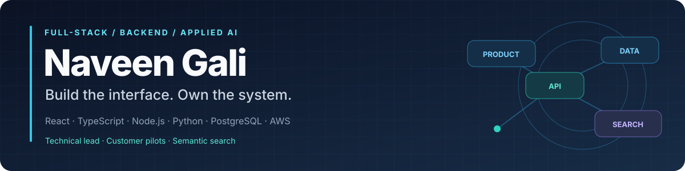
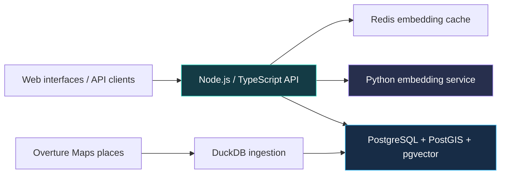

### Hi, I'm Naveen

I'm a **full-stack engineer and technical lead** who enjoys turning customer problems into working products. My work spans React/Next.js interfaces, TypeScript and Python services, APIs, data pipelines, and cloud deployments.

I'm looking for a **full-time product, full-stack, founding-engineer, or backend role on a small team**, bringing my founding-engineer experience at Polyhistor to a new product. Based in **Washington, DC**; open to remote work and relocation, including SF and NYC.

---

## Selected work

### Polyhistor — location intelligence from data to customer pilot

My hands-on work spans the TypeScript/React pilot interfaces, Next.js website, backend services, geospatial database architecture, ingestion pipeline, and APIs.

- Shipped neighborhood-insight pages and walkability, greenery, and noise-scoring APIs for **Inhotel Inc.'s European-city pilot**.
- Built custom **Mapbox** modules and **D3** visualizations for location insights.
- Built a **DuckDB** pipeline over **3.55M+ Overture Maps places**, avoiding the memory failures of the earlier Pandas approach.
- Combined **PostgreSQL/PostGIS, pgvector, Sentence-Transformers, and HNSW** in D-GIX for spatial and semantic search; added Redis embedding caching, persistent HTTP connections, and batch lookups.

[Product](https://www.thepolyhistor.com/) · [Website source](https://github.com/Polyhistor-Inc/Polyhistor-Website)

<strong>D-GIX benchmark results and conditions</strong>

| Result | Evaluation context |
| --- | --- |
| **0.97 Recall@10** | 70 curated semantic queries; category-based relevance |
| **19ms median warm-cache search** | Repeat queries with embeddings cached in Redis |
| **116ms median first-time search** | Query embedding uncached; model already loaded |
| **4,414 requests, zero failures** | Separate 100-user, 60-second test on a read-heavy cached endpoint |
| **98.7% lower modeled cost vs. Google Places** | Pricing scenario of one million monthly requests |

These are benchmark and modeled-cost results. The cached-endpoint test does not establish zero failures across the entire API. The current density signal is inferred from place attributes.

## Projects you can explore

<table>
<tr>
<td width="50%" valign="top">

### 🔬 [STAIR retrieval reproduction](https://github.com/NaveenGali11/stair-rag-reproduction)

An independent, **one-book retrieval study** comparing BM25, dense retrieval, DSI, and structure-aware generative retrieval.

Frozen metrics, an executed notebook, reproduction scripts, and documented limitations.

**Python · Retrieval evaluation · Reproducibility**

</td>
<td width="50%" valign="top">

### 🛠️ [ShipSolid](https://github.com/NaveenGali11/ShipSolid)

A **code-audit CLI** that combines Semgrep findings, Claude analysis, and PDF reporting.

Turns technical scan findings into reports that founders and engineering teams can review.

**TypeScript · Node.js · Applied AI**

</td>
</tr>
<tr>
<td width="50%" valign="top">

### 📝 [ResumeForge](https://github.com/NaveenGali11/Resumeforge)

A **browser-based LaTeX editor** with a PDF compilation service and heuristic resume/JD analysis.

A React/TypeScript interface, Express API, and local Docker setup.

**React · TypeScript · Node.js · Docker**

</td>
<td width="50%" valign="top">

### 🌐 [Polyhistor website](https://github.com/Polyhistor-Inc/Polyhistor-Website)

The **Next.js website** for Polyhistor's location-intelligence platform.

Connects the platform's technical capabilities to a public product experience.

**Next.js · TypeScript · Product delivery**

</td>
</tr>
</table>

Also available: [the earlier Polyhistor consumer-app backend](https://github.com/NaveenGali11/polyhistor-backend), a public fork using Node.js, Express, TypeScript, PostgreSQL/PostGIS, JWT, and Socket.IO. It is separate from the D-GIX search architecture.

## Stack I work with

- **Frontend & visualization:** React, Next.js, React Native, TypeScript, JavaScript, HTML5, CSS, Mapbox, D3
- **Backend & APIs:** Node.js, Express, Python, Django, Java, Spring Boot, REST, GraphQL, WebSockets
- **Data & search:** PostgreSQL, PostGIS, pgvector, MongoDB, Redis, DuckDB, H3, embeddings, HNSW
- **Cloud & quality:** AWS, Docker, Kubernetes, Terraform, GitHub Actions, Jest, Playwright, Storybook
- **AI & developer tools:** LLM integration, RAG, Sentence-Transformers, Cursor, Claude Code, Codex

<strong>Under the hood: the Polyhistor search stack</strong>

The search system combines semantic retrieval with spatial filtering. Redis caches query embeddings, while PostgreSQL brings relational, spatial, and vector data together.

<strong>Experience & education</strong>

### Experience

**Polyhistor Inc. — Software Engineer & Technical Lead**  
*Jan 2026–Present*  
Lead platform architecture and hands-on full-stack delivery with a small engineering team; helped lead the pivot from a consumer travel product to an enterprise geospatial API and customer pilot.

**Rebecca Everlene — Software Development Engineer II**  
*Jan 2025–Jan 2026*  
Led Landmarks from concept to public beta in four months while coordinating 12 engineers across React Native and Node.js. Built a Storybook component library that cut feature delivery time by 30%, and established CI/CD and review standards.

**Grid Dynamics — Software Engineer**  
*Dec 2022–Sep 2023*  
Built Java/Spring Boot services processing 50K+ daily transactions at 99.9% uptime and a GraphQL layer that improved screen load times by 30%. Led a 150K+ line TypeScript migration and reduced Android crash rates by 15%.

**IG Defence — Software Engineer**  
*Jul 2020–Dec 2022*  
Rebuilt OAuth/JWT authentication and dashboard flows across 10,000+ business accounts, increasing retention by 50%. Built WebSocket/Redis notifications that reduced alert latency to under two seconds.

### Education

**M.S. in Computer Science**, Illinois Institute of Technology — May 2025  
**Bachelor's degree in Computer Science**, Bharath Institute of Higher Education — 2023

---

**Let's build something useful.**  
[LinkedIn](https://www.linkedin.com/in/naveen-gali/) · [Email](mailto:naveengali80@gmail.com) · [Polyhistor](https://www.thepolyhistor.com/)

